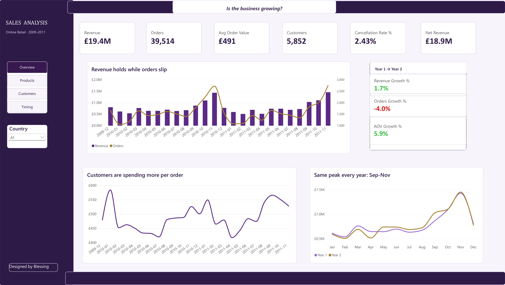
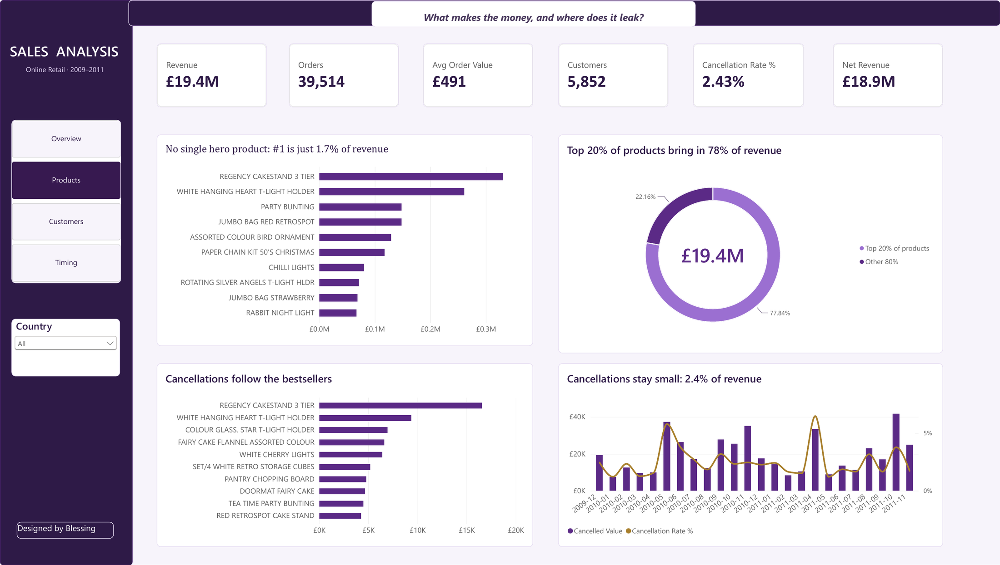
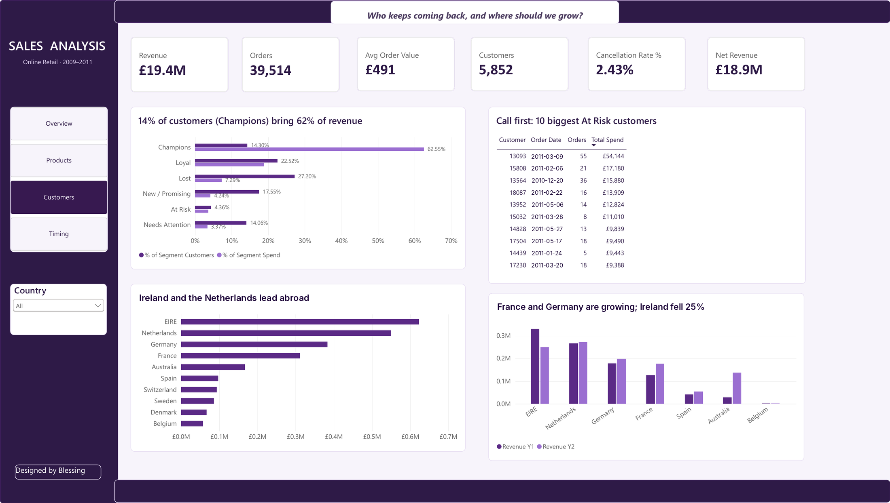
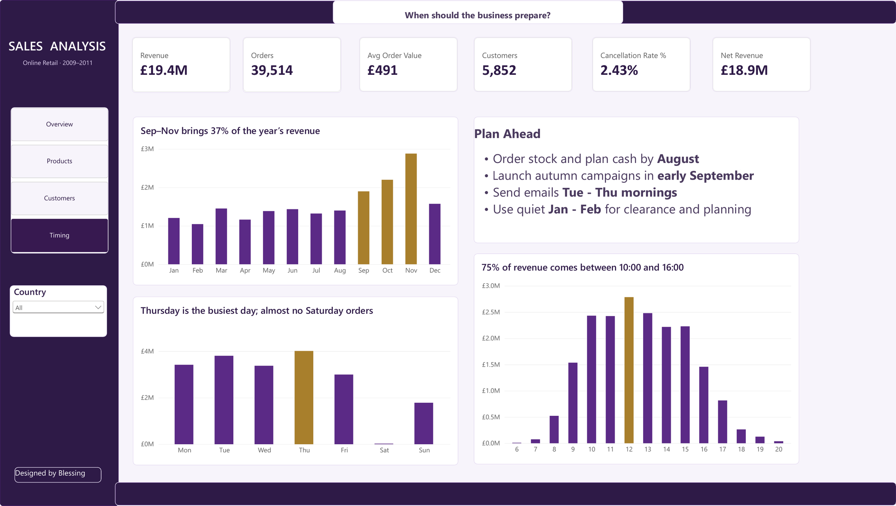

# Online Store Sales Analysis

Two years of messy transaction data from a UK online gift retailer, turned into a Power BI dashboard, a customer call list and a report the business owner can act on.

**Tools:** PostgreSQL, Power BI (DAX, Power Query), Excel

**Owner report:** [report/monthly_report.pdf](report/monthly_report.pdf)

---

## The business problem

A UK-based online gift retailer, whose customers are largely wholesalers, has two years of sales records but no clear view of how the business is performing. The owner asked six questions:

1. Is the business growing?
2. What actually makes the money?
3. Where is money leaking?
4. Who keeps coming back?
5. Where should we grow next?
6. When should we prepare for peak season?

---

## Key findings

| Question | Answer |
|---|---|
| Is the business growing? | Only slightly. Revenue rose 1.7%, but orders fell 4.0%. All of the growth came from bigger orders, with average order value up 5.9%. |
| What makes the money? | A core range rather than one hero product. The best-selling product is only 1.7% of revenue, but 292 products (6% of the range) bring in half of all revenue, and the top 20% bring in 78.4%. |
| Where is money leaking? | Cancellations are small and falling, at 2.43% of revenue. Fees cost more: £264,936 in total, including £221,521 in Amazon fees. |
| Who keeps coming back? | Repeat customers bring in 96.7% of revenue. The 325 customers with 20 or more orders bring in 47.4%. Of the customers who bought in Year 1, 63.9% bought again in Year 2. |
| Where should we grow next? | Outside the UK. International revenue grew 12.1% while UK revenue stayed flat. France (+40.6%) and Germany (+11.5%) have the broadest customer base abroad. |
| When should we prepare? | September to November brings in 36.8% of the year's revenue. Thursday is the busiest day, and 75% of revenue arrives between 10:00 and 16:00. |

**Customer segments.** The 837 Champions (14% of customers) bring in 62.5% of revenue. The 255 At Risk customers, who used to order often but have gone quiet for six to twelve months, represent £618,264 of past spending. The owner report lists the ten to contact first.

---

## Dashboard

The dashboard has four pages, each answering one or two of the owner's questions. Every chart title states the finding rather than just the topic.

| Page | Questions answered |
|---|---|
| Overview | Is the business growing? |
| Products | What makes the money, and where is it leaking? |
| Customers | Who keeps coming back, and where should we grow? |
| Timing | When should the business prepare? |

---

## Recommendations

1. Contact the 255 At Risk customers this month, starting with the ten biggest listed in the report.
2. Protect the Champions with early access to new stock and wholesale terms, rather than discounts.
3. Have stock and cash ready by August for the September to November peak, and launch autumn campaigns in early September.
4. Grow sales in France and Germany, and check in with the three Irish accounts, where revenue fell 25%.
5. Review whether the Amazon channel is profitable after £221,521 in fees.
6. Investigate products with very high cancellation rates. One product had 81.8% of its sales cancelled.

---

## The data

| Item | Detail |
|---|---|
| Source | [Online Retail II, UCI Machine Learning Repository](https://archive.ics.uci.edu/dataset/502/online+retail+ii) |
| Creator | Daqing Chen (2012), licensed under CC BY 4.0 |
| Period | 1 December 2009 to 9 December 2011 |
| Raw size | 1,067,371 rows across two Excel sheets |

The raw file is not stored in this repository. It can be downloaded from the source link above.

---

## Data cleaning

Each cleaning stage was saved as its own table, so every step can be checked and rerun. The raw tables were never changed.

| Stage | Rows | What changed |
|---|---|---|
| Raw data (two sheets) | 1,067,371 | Loaded as text so that no rows were rejected on import |
| Overlap removed | 1,044,848 | The two sheets overlap: 1 to 9 December 2010 appears in both (22,523 identical rows) |
| Data types fixed | 1,044,848 | Text converted to numbers and dates (Excel had saved the dates as month/day/year) |
| Duplicates removed | 1,033,036 | 11,812 identical lines removed |
| Rows labelled | 1,033,036 | Cancellations flagged; postage, fees, adjustments and test entries separated from products |
| Final sales table | 1,003,355 | Products only, not cancelled, with quantity and price above zero; two reversed data-entry errors worth £245,653 removed |

**Judgement calls**

- **Cancellations are not the same as lost sales.** Of £1.46 million in cancelled lines, only £716,463 came from customers cancelling products. The rest were accounting adjustments, fees and postage refunds. After removing two data-entry errors, product cancellations total £470,809.
- **Blank customer IDs were kept.** These rows make up 13.3% of revenue, so they count toward revenue but are left out of the customer analysis. Deleting them would have made the business look £2.58 million smaller.
- **Unusual codes were checked, not deleted.** Stock codes starting with DCGS looked like system codes, but their descriptions showed they are real products.
- **The analysis caught what cleaning missed.** A product with a single order ranked fourth in sales. It turned out to be an 80,995-unit order that was reversed twelve minutes later.
- **December 2011 is a partial month,** covering only nine days, so year-on-year comparisons use two full twelve-month periods.

---

## Repository contents

| Folder | File | Purpose |
|---|---|---|
| sql | 01_create_raw_tables.sql | Creates the staging tables and loads the CSV files |
| sql | 02_combine_sheets.sql | Proves and removes the overlap between the two sheets |
| sql | 03_clean_data.sql | Fixes data types, removes duplicates, labels rows and builds the final tables |
| sql | 04_q1_growth.sql | Question 1: Is the business growing? |
| sql | 05_q2_products.sql | Question 2: What makes the money? |
| sql | 06_q3_leaks.sql | Question 3: Where is money leaking? |
| sql | 07_q4_customers.sql | Question 4: Who keeps coming back? |
| sql | 08_q5_markets.sql | Question 5: Where should we grow next? |
| sql | 09_q6_timing.sql | Question 6: When should we prepare? |
| sql | 10_customer_segments.sql | Customer segmentation and the call list |
| powerbi | online_retail_dashboard.pbix | The Power BI dashboard |
| powerbi | powerbi_measures.dax | All Power BI measures, with expected values |
| powerbi | purple_theme.json | The dashboard colour theme |
| images | (screenshots) | Dashboard pages and query results |
| report | monthly_report.pdf | Report for the business owner |

---

## How to reproduce

1. Download the dataset from the UCI link above and save each Excel sheet as a CSV file.
2. In PostgreSQL, run the files in the sql folder in order, from 01 to 10.
3. Open online_retail_dashboard.pbix in Power BI and connect it to the PostgreSQL database (server: localhost, database: online_retail).

---

*Author: Blessing*
